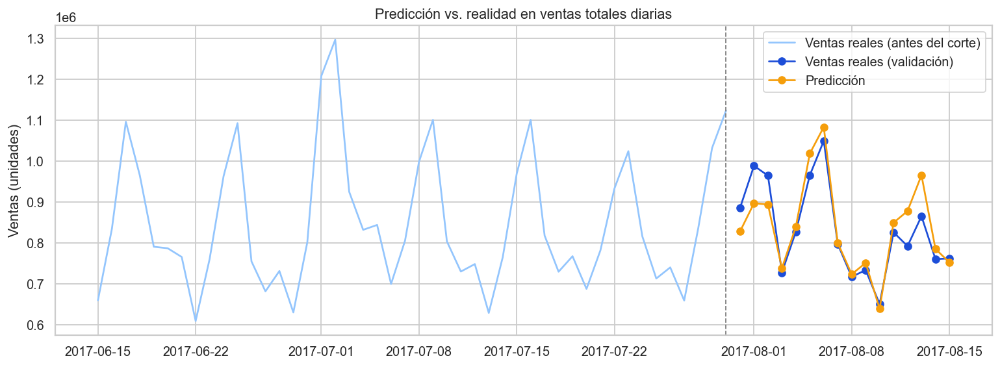
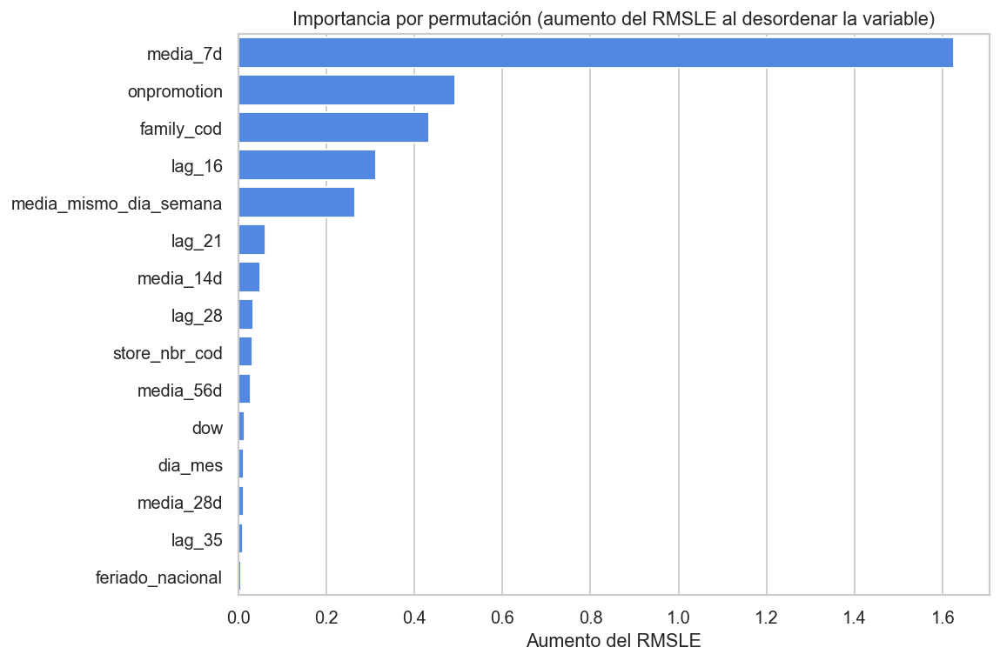

# Pronóstico de ventas de supermercado: Store Sales (Favorita, Ecuador)


Proyecto de series de tiempo con los datos de la competencia de Kaggle [Store Sales - Time Series Forecasting](https://www.kaggle.com/competitions/store-sales-time-series-forecasting). Predigo las ventas diarias de cada familia de producto en cada tienda de Favorita durante los **16 días** siguientes al último día de entrenamiento, y evalúo con la métrica de la competencia, **RMSLE**.

## Resultados

Validación sobre los últimos 16 días de entrenamiento (31 de julio al 15 de agosto de 2017), 1.782 series (54 tiendas × 33 familias):

| Modelo | RMSLE | Mejora frente a la media de 28 días |
|---|---|---|
| **Gradient boosting** | **0,3967** | **26,2 %** |
| Gradient boosting + regla de ceros | 0,4022 | 25,2 % |
| Media de 28 días | 0,5378 | referencia |
| Mismo día de la semana (4 semanas) | 0,5398 | −0,4 % |

- El gradient boosting reduce el error un 26 % frente a la mejor regla simple.
- La regla de ceros **empeora** el resultado (0,4022 frente a 0,3967), así que no la uso en las predicciones finales: algunas series que llevaban 28 días sin vender volvieron a vender en la ventana de validación.
- **Puntaje público en Kaggle: 0,4376** (16 al 31 de agosto de 2017). Es más alto que el de validación (0,3967): usé una sola ventana de 16 días, así que la validación resultó optimista.
- La competencia es de práctica y no otorga puntos de ranking.





## Enfoque

1. **Exploración:** tendencia, estacionalidad semanal, día de pago (el 15 y el último día del mes), participación por familia, promociones y días sin registros en el calendario.
2. **Validación que imita el problema real:** entreno con lo anterior a una fecha de corte y evalúo en los últimos 16 días. No uso validación aleatoria porque mezclaría el futuro con el pasado.
3. **Modelos de referencia:** media de 28 días y media de las últimas 4 semanas por día de la semana. Sirven para saber si el modelo realmente aporta.
4. **Gradient boosting** (`HistGradientBoostingRegressor`) sobre `log1p(ventas)`, con:
   - rezagos y medias móviles con al menos 16 días de antigüedad, para que estén disponibles el día de la predicción,
   - calendario, día de pago, feriados nacionales (sin los trasladados) y eventos,
   - promociones, datos de la tienda, familia y precio del petróleo con rezago.
5. **Regla de negocio (evaluada y descartada):** predecir 0 si una serie no vendió nada en los últimos 28 días. Solo se aplica si mejora el RMSLE en validación, y en este caso no lo hizo.
6. **Diagnóstico:** error por familia e importancia de variables por permutación.

## Cómo ejecutarlo

1. Entra a la [página de la competencia](https://www.kaggle.com/competitions/store-sales-time-series-forecasting), acepta las reglas y descarga los datos en una carpeta `data/` junto al notebook. Con la CLI de Kaggle (necesita tu token de API):

```bash
kaggle competitions download -c store-sales-time-series-forecasting -p data
```

Descomprime el `.zip` dentro de `data/` para que queden `train.csv`, `test.csv`, `stores.csv`, `oil.csv` y `holidays_events.csv`.

2. Instala las dependencias y abre el notebook:

```bash
pip install -r requirements.txt
jupyter notebook forecasting_ventas.ipynb
```

El notebook genera `metricas.csv`, los gráficos de `imagenes/` y `submission.csv` (este último se sube a la competencia y no se incluye en el repositorio).

## Contenido del repositorio

| Archivo | Descripción |
|---|---|
| `forecasting_ventas.ipynb` | Análisis, modelos y evaluación |
| `metricas.csv` | RMSLE de cada modelo en la validación |
| `imagenes/` | Gráficos generados por el notebook |
| `requirements.txt` | Dependencias |

## Fuente de los datos

Datos de la competencia de Kaggle [Store Sales - Time Series Forecasting](https://www.kaggle.com/competitions/store-sales-time-series-forecasting) (ventas de la cadena de supermercados Favorita, Ecuador). Según las reglas de la competencia, los datos solo pueden usarse para la competencia y para investigación y educación sin fines comerciales, y no pueden redistribuirse, por lo que **no se incluyen en este repositorio**.

## Autor

**Daniel Camelo** · [GitHub](https://github.com/danielcaru1-lab) · [LinkedIn](https://www.linkedin.com/in/daniel-fernando-camelo-ruiz)
